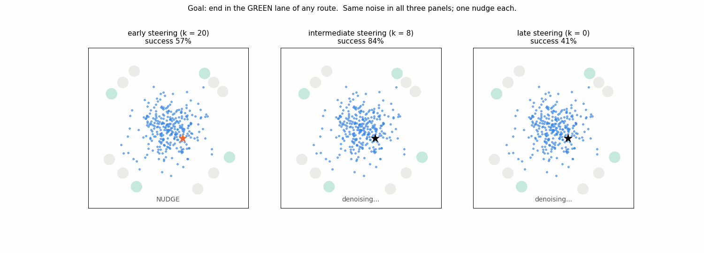
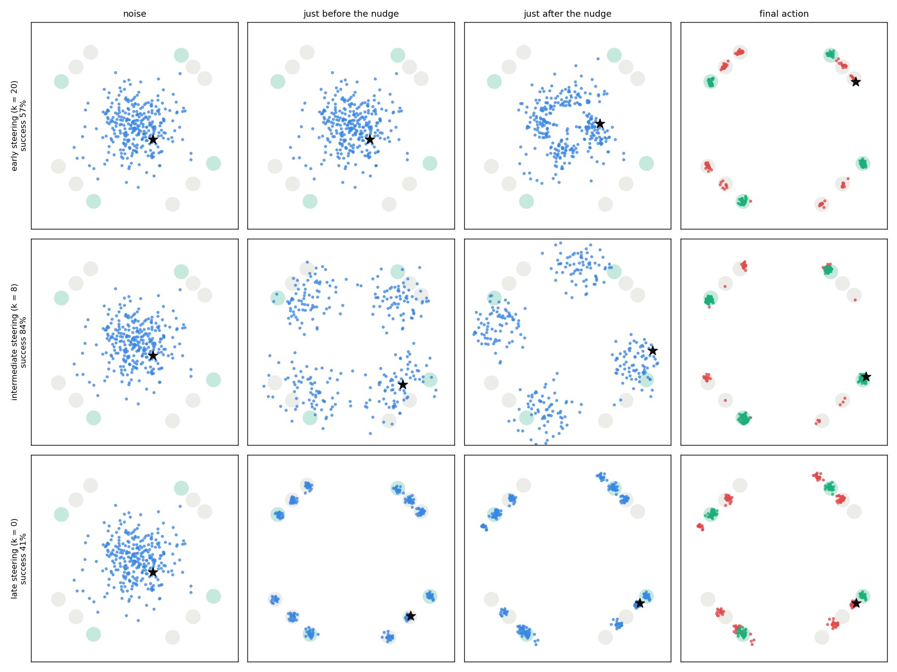

# When to steer a diffusion model: a 2D toy

A frozen diffusion model turns noise into an "action" over 20 denoising steps.
We nudge the sample **once**, at one step, toward a goal. We compare nudging at
the start (pure noise), in the middle, and at the end (the finished action).



## Setup

* **Data (the "policy"):** a 2D Gaussian mixture.
  * 4 *routes* (clusters on a ring of radius 4).
  * Each route is split into 3 *lanes*: sub-clusters along the route's tangent,
    each with standard deviation 0.12.
  * Lane spacing differs from route to route (0.8, 1.0, 1.2, 1.4).
  * In total there are 12 tight modes. A valid action is a point within 3
    standard deviations of a lane centre.
* **Model:** the denoiser of a Gaussian mixture is known in closed form, so the
  diffusion model is **exact** and nothing is trained. Sampling uses 20
  deterministic DDIM steps on a cosine schedule. Step 20 is pure noise and
  step 0 is the final action.
* **Goal:** "end in the green lane of any route". The green lane is the
  counter-clockwise lane of each route. The goal is the same for every sample
  and every step, and is scored as `log p(lane = green | a)`.
* **One nudge at step k:**
  `x_k <- x_k + eps * D_k^2 g / ||D_k g||`, with
  `g = d log p(green | sample(x_k)) / d x_k`.
  * The gradient is taken through all remaining denoising steps.
  * `D_k` is the per-step scale of `x_k`, measured from unguided rollouts.
  * After the nudge, sampling finishes normally.
* **Evaluation:** 4000 samples, with the same starting noise for every k. The
  nudge size `eps` is chosen per step on the first half of the samples, and
  success is reported on the other half (2000 samples).

## Result

| one nudge at… | success |
|---|---|
| start (step 20) | 57% |
| **middle (step 8)** | **84.5%** |
| end (step 0) | 41% |

Without steering, success is 32%. 421 of the 2000 test samples fail early,
succeed mid-way and fail late; 1 sample shows the reverse. The star in the
video follows one of these 421 samples. Exact numbers for every step are in
`demo_numbers.txt`.



**What happens (stills above: noise, just before the nudge, just after, final):**

* **Start:** nothing has formed yet. Which lane a sample ends in depends on
  tiny details of the noise, so the nudge is scrambled by the remaining
  denoising, and many samples land in valid but **wrong** lanes.
* **Middle:** the routes have formed but the lane is still undecided. The nudge
  tips the lane decision, and the remaining denoising **pulls the sample cleanly
  into the green lane**. You steer while the model can still recover a valid
  action.
* **End:** the action is finished, so the nudge just moves the point. Lane
  spacing differs by route, so one nudge size cannot fit every lane. Many points
  end up **between lanes**, which is an invalid action.

**Why:** coarse decisions (which route) are made early in sampling, roughly
steps 15–8, and finer ones (which lane) later, roughly steps 7–1. A nudge is
amplified only while the decision it targets is still open. Exactly: one DDIM
step's Jacobian is a blend of the identity and the denoiser Jacobian, and a
nudge grows along a direction only where the denoiser Jacobian has an
eigenvalue above 1. The right panel of `toy_intermediate_steering_fixed.png`
shows these windows, computed from the frozen model alone.

## More goals (`toy_intermediate_steering_fixed.png`, `toy_intermediate_steering.png`)

`python toy_intermediate_steering.py --fixed` sweeps every step for goals that
are fixed functions of the action. Each sample gets a random target, drawn
independently of where it was heading:

* **"End in lane j\*, any route":** best in the middle (step 3), 66%, against
  53% at the start and 48% at the end.
* **"End in lane j\* of route r\*":** best at step 13 (36%), between the route
  window and the lane window.
* **"Hit a point near a random lane":** this needs a mode switch *and*
  precision. No single nudge does it (at most 4%).

`python toy_intermediate_steering.py` uses goals defined relative to where each
sample was heading: "choose a route", "keep your route, move one lane", and
"precise point in your own lane". These favour start, middle and end
respectively. The lane goal here (94% mid-way) overstates the effect, because
"keep your route" builds in the assumption that the coarse decision is already
right.

## Run

```bash
pip install -r requirements.txt
python make_demo.py                             # video, stills, demo_numbers.txt   (~30 s on CPU)
python toy_intermediate_steering.py --fixed     # toy_intermediate_steering_fixed.png (~1 min)
python toy_intermediate_steering.py             # toy_intermediate_steering.png       (~30 s)
```

Everything runs on CPU and the outputs are deterministic (fixed seeds).

## Files

| file | contents |
|---|---|
| `toy_intermediate_steering.py` | mixture, exact DDIM sampler, goals, one-nudge steering, decision windows, figures |
| `make_demo.py` | the green-lane demo: GIF, stills, numbers |
| `demo_steering_timing.gif`, `demo_steering_timing_frames.png`, `demo_numbers.txt` | demo outputs |
| `toy_intermediate_steering_fixed.png`, `toy_intermediate_steering.png` | sweep figures |
| `requirements.txt` | torch, numpy, matplotlib, pillow |

## Limitations

* This is a 2D toy with an exact model, and the steering is a single gradient
  step (guidance) whose size is tuned per step.
* It isolates *when* to steer. It does not show that a learned controller or a
  robot policy behaves the same way.
